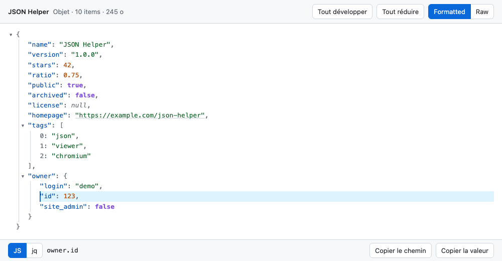

# JSON Helper — visualiseur JSON pour Chrome, Brave et Edge

[Télécharger JSON Helper <i class="bi bi-arrow-right"></i>](https://github.com/guitehub/json-helper/releases/latest){: .app-button}

À QUOI ÇA SERT
--------------
Quand on ouvre une API ou un fichier .json dans le navigateur, on tombe
sur un gros pavé de texte illisible. JSON Helper est une extension qui le
remplace par une arborescence colorée et pliable :
  - chaque objet et chaque tableau se replie d'un clic (Alt+clic pour tout
    le sous-arbre), avec un compteur `{… 12 items}` quand c'est replié ;
  - un clic sur une ligne affiche son chemin en bas de page
    (`owner.id`, ou `.owner.id` en notation jq), avec « Copier le chemin »
    et « Copier la valeur » ;
  - un bouton Formatted / Raw ramène au texte brut d'origine ;
  - thème clair ou sombre selon le système, liens http(s) cliquables.

Elle reste fidèle au texte source : l'ordre des clés est conservé, les
grands entiers (IDs 64 bits) ne sont pas arrondis et les clés dupliquées
restent visibles, là où beaucoup de visualiseurs repassent par
`JSON.parse` et perdent ces détails.

COMMENT ON L'INSTALLE
---------------------
Pas de Web Store : on la charge à la main, en deux minutes.

1. Télécharger `json-helper-X.Y.Z.zip` depuis la
   [dernière release](https://github.com/guitehub/json-helper/releases/latest)
   et le décompresser dans un dossier durable (pas Téléchargements :
   le navigateur recharge l'extension depuis ce dossier à chaque démarrage).
2. Ouvrir `chrome://extensions` (ou `brave://extensions`, `edge://extensions`).
3. Activer le **Mode développeur**.
4. **Charger l'extension non empaquetée** et choisir le dossier qui contient
   `manifest.json`.
5. Facultatif : dans **Détails**, activer **Autoriser l'accès aux URL de
   fichiers** pour formater aussi les .json ouverts depuis le disque.

Pour vérifier : ouvrir <https://api.github.com/repos/nodejs/node>, la barre
JSON Helper doit apparaître en haut de la page. Le
[README](https://github.com/guitehub/json-helper#readme) détaille la mise à
jour et le dépannage.

SUR QUELLE TECHNO C'EST BÂTI
----------------------------
Une extension Manifest V3 en trois fichiers (manifest.json, content.js,
styles.css) : JavaScript vanilla, sans aucune dépendance.

Elle ne demande aucune permission et ne fait aucune requête réseau : tout
se passe dans l'onglet.
  - Détection : le script lit `document.contentType` et s'arrête aussitôt
    sur une page HTML normale, donc coût quasi nul en navigation.
  - Parseur fidèle : `JSON.parse` valide le document, puis un petit parseur
    maison construit l'arbre affiché en gardant le texte exact.
  - Sécurité : tout le DOM est construit via `textContent`, jamais
    `innerHTML`, donc aucune injection possible depuis le contenu JSON.
  - Performance : les nœuds repliés ne sont créés qu'à leur première
    ouverture, et au-delà de 2 Mo la vue brute s'affiche par défaut.

Les tests tournent avec `node --test`, et pousser une étiquette `vX.Y.Z`
publie automatiquement une release GitHub avec le zip prêt à installer.

Le code est sur GitHub, sous licence MIT :
[guitehub/json-helper](https://github.com/guitehub/json-helper).
