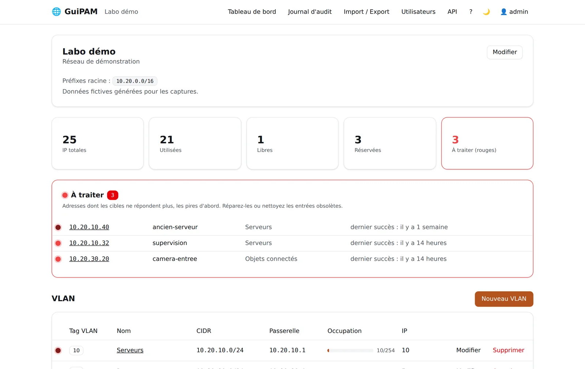
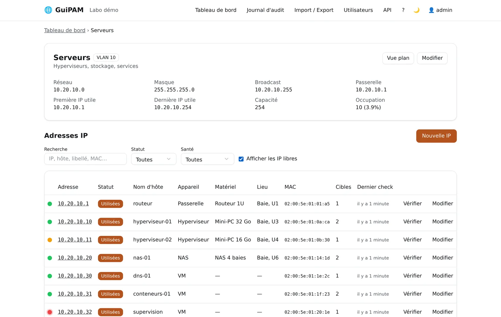
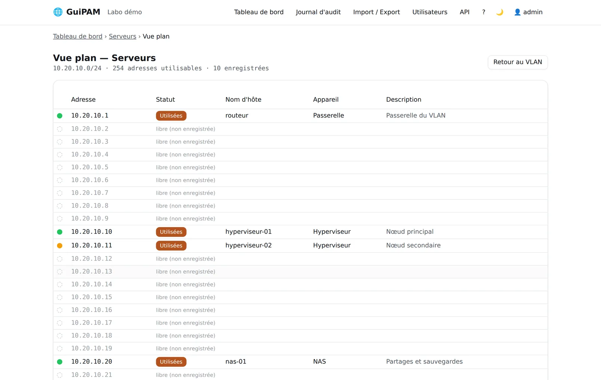
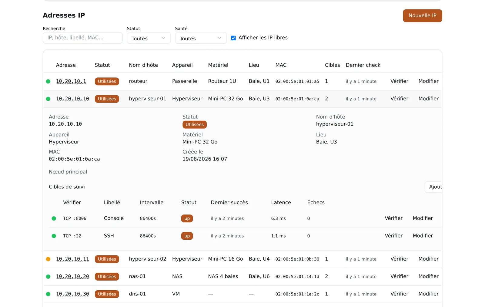
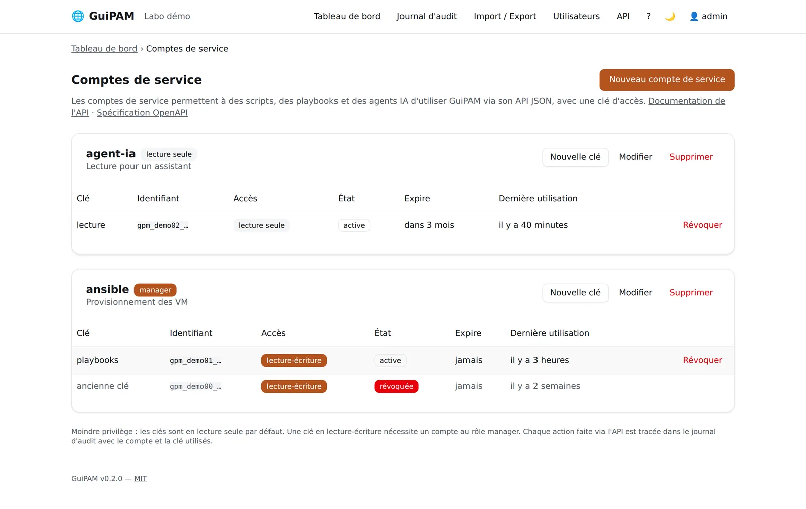
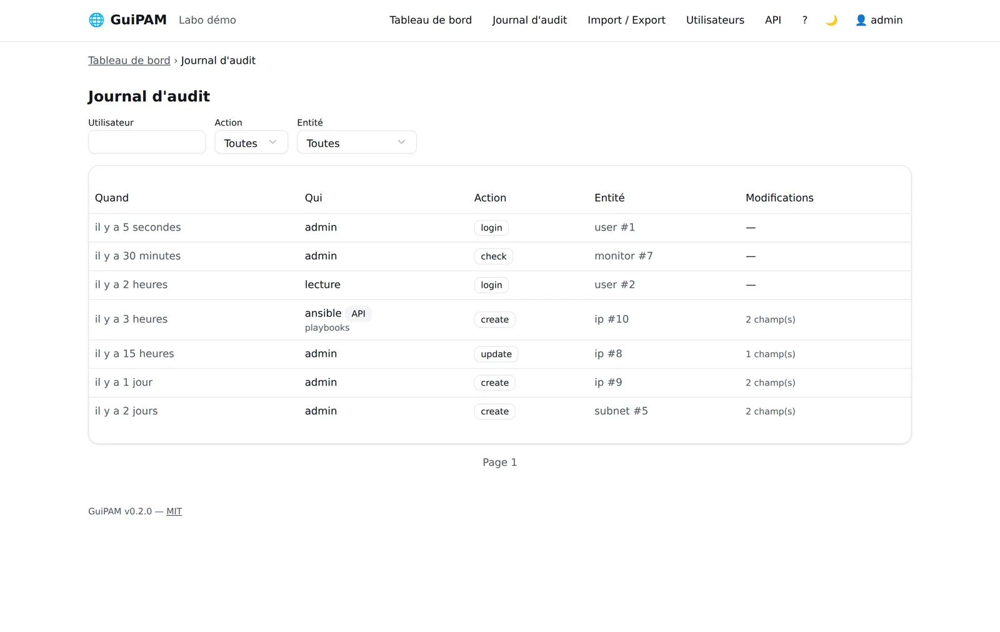

# GuiPAM — l'IPAM du homelab, avec suivi dynamique

[Voir GuiPAM sur GitHub <i class="bi bi-arrow-right"></i>](https://github.com/guitehub/GuiPAM){: .app-button}

À QUOI ÇA SERT
--------------
GuiPAM remplace le fichier Excel où l'on note les adresses IP d'un homelab ou d'une
petite entreprise. En plus de l'inventaire, il vérifie tout seul si chaque machine
répond encore, et montre d'un coup d'œil quelles entrées sont vivantes et lesquelles
sont probablement mortes depuis longtemps.



Le tableau de bord met en avant ce qui est **à traiter** : les adresses dont les
machines ne répondent plus, les pires d'abord. Les captures de cet article viennent
d'une instance de démonstration remplie de données fictives.

L'inventaire
------------
Le réseau est découpé en VLAN. Pour chacun, GuiPAM calcule le masque, la passerelle,
la capacité et l'occupation, et liste les adresses : statut (utilisée, réservée,
libre), nom d'hôte, appareil, matériel, lieu, MAC.



Il refuse les erreurs classiques d'un tableur : CIDR invalide, VLAN qui se
chevauchent, adresse hors de son VLAN, doublon, passerelle hors réseau, VLAN plein.

La **vue plan** intercale les adresses libres entre les adresses enregistrées, pour
voir les trous où placer une nouvelle machine.



Le suivi dynamique
------------------
Chaque adresse peut avoir des **cibles de suivi** : un port TCP (SSH, HTTPS, une
console…) ou un ping. GuiPAM les vérifie à intervalle régulier, et la pastille
prend la couleur de la fraîcheur du dernier succès : vert, puis ambre, rouge, et
enfin rouge foncé pour une entrée qui ne répond plus depuis si longtemps qu'elle est
sans doute à nettoyer. Les seuils se règlent.



Une API pour les machines
-------------------------
Tout ce que l'interface permet sur les VLAN, les adresses et le suivi existe aussi en
JSON, sous `/api/v1`, avec exactement les mêmes règles. Un script, un playbook
Ansible ou un agent IA peut par exemple demander « la prochaine adresse libre de ce
VLAN » et la réserver en une seule requête.



Les machines utilisent des **comptes de service** avec des clés d'accès : en lecture
seule par défaut, affichées une seule fois, révocables d'un clic. La spécification
OpenAPI est servie par l'application, suffisante pour qu'un agent s'en serve sans
autre notice.

Qui a fait quoi
---------------
Deux rôles, `manager` (lecture et écriture) et `user` (lecture seule), et un journal
d'audit de toute modification, y compris celles faites par l'API, avec le compte et
la clé utilisés.



COMMENT ON L'INSTALLE
---------------------
GuiPAM s'auto-héberge, sur le réseau qu'il gère : un conteneur Docker et un dossier
de données.

```bash
git clone https://github.com/guitehub/GuiPAM.git && cd GuiPAM
cp .env.example .env
# Dans .env : GUIPAM_SECRET_KEY (openssl rand -hex 32) et GUIPAM_ADMIN_PASSWORD
docker compose up -d --build
```

Puis ouvrir <http://localhost:8080>. Il n'y a ni compte ni mot de passe par défaut :
le premier compte est celui défini dans `.env`.

Il est fait pour durer : une mise à jour ne doit jamais faire perdre de données.
Avant chaque changement de structure, GuiPAM prend un instantané de sa base, en garde
un par jour, et sait exporter une sauvegarde complète que toutes ses versions futures
sauront relire. Le [README](https://github.com/guitehub/GuiPAM#readme) détaille la
configuration, les sauvegardes et l'API.

SUR QUELLE TECHNO C'EST BÂTI
----------------------------
  - Python 3.12 et FastAPI, base SQLite, schéma migré automatiquement au démarrage
    (Alembic) ;
  - pages rendues côté serveur (Jinja2), rendues vivantes avec HTMX et Alpine.js :
    les pastilles se rafraîchissent toutes seules, sans framework JavaScript ;
  - Tailwind CSS et les composants [Basecoat](https://basecoatui.com), habillés par
    [guitestyle](), le style de ce site, en copie
    locale figée ;
  - **aucun CDN** : tout est servi par l'application, qui marche hors-ligne. Pour un
    outil réseau, c'est essentiel : on l'ouvre justement quand quelque chose est en
    panne ;
  - interface en français, prête pour d'autres langues ;
  - conteneur non-root, jeton anti-CSRF, sessions durcies, clés d'API stockées
    hachées.

Le code est sur GitHub, sous licence MIT :
[guitehub/GuiPAM](https://github.com/guitehub/GuiPAM).
